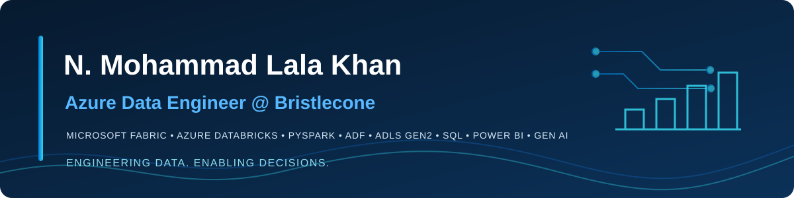

Data professional with **4 years of experience** across SQL, Power BI, and analytics, now focused on building end-to-end data engineering solutions across Azure and modern lakehouse platforms.

---

| Area | Technologies |
|---|---|
| **Azure & Data Platforms** | Microsoft Azure, Microsoft Fabric, Azure Data Factory, ADLS Gen2, Azure Databricks |
| **Data Engineering** | ETL/ELT, batch ingestion, full and incremental loads, watermark framework, metadata-driven pipelines, orchestration, monitoring, validation |
| **Big Data & Programming** | PySpark, Apache Spark, Python, Pandas, NumPy |
| **Databases** | SQL, SQL Server, MySQL, joins, CTEs, window functions, stored procedures |
| **Lakehouse & Modelling** | Bronze/Silver/Gold architecture, Delta Lake concepts, dimensional modelling, Star Schema |
| **BI & Visualization** | Power BI, DAX, Power Query, Tableau, Excel, KPI dashboards, RLS |
| **Tools** | Git, GitHub, Azure DevOps |

---

### Bristlecone India Limited
**Associate Visualization Specialist (Data Engineer)** · *June 2026 – Present*  
Client: **Skyworks Solutions** · Semiconductor Supply Chain

Working across data and analytics initiatives with exposure to Azure Databricks, Microsoft Fabric, PySpark, Azure Data Factory, SQL, and Power BI.

### Tata Consultancy Services (TCS)
**Data Analytics · SQL · Power BI** · *April 2022 – March 2026*

- **GE Healthcare** · *April 2022 – March 2023*  
  Developed SQL and Power BI reporting for KPI and asset-utilization analysis, using SQL Server, Oracle, Excel, Power Query, and DAX.
- **Tata Play** · *April 2023 – March 2026*  
  Supported subscriber, revenue, and churn analytics; built Power BI semantic models and reports using SQL, DAX, Power Query, Star Schema, drill-through, and Row-Level Security.

---

### NEXUS BANK · Azure Data Engineering
[**Project Repository**](https://github.com/nayancheruvumohammad4370/NEXUS-BANK-DATA-ENGINEERING)

Ongoing end-to-end project using ADF, ADLS Gen2, Azure Databricks, and PySpark. Implemented metadata-driven Bronze ingestion, incremental transaction ingestion, customer ingestion, and master orchestration. Silver and Gold development is in progress.

### SQL Server → ADF → ADLS Gen2 Migration
[**Project Repository**](https://github.com/nayancheruvumohammad4370/SQL-SERVER-ADF-ADLS-MIGRATION)

Implemented a 10,000-row DimCustomer full load from local SQL Server to ADLS Gen2 Bronze in Parquet using Self-hosted Integration Runtime and ADF, with watermark-based incremental loading and stored-procedure integration.

### BI, SQL & Python Analytics
[**Explore all repositories**](https://github.com/nayancheruvumohammad4370?tab=repositories)

Power BI dashboards, SQL analysis, Python EDA, Tableau visualizations, and Excel analytics.

---

- Microsoft Certified: Power BI Data Analyst Associate · **PL-300**
- Microsoft Certified: Fabric Data Engineer Associate · **DP-700**
- Microsoft Certified: Azure Data Fundamentals · **DP-900**
- Databricks Fundamentals
- Generative AI Foundation
